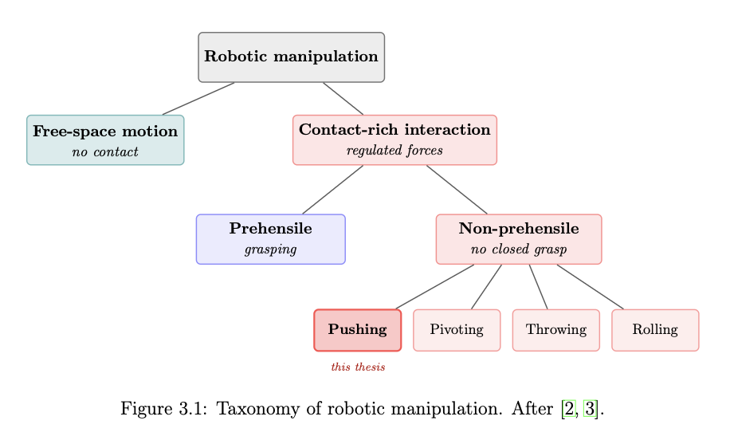
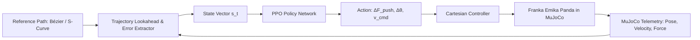
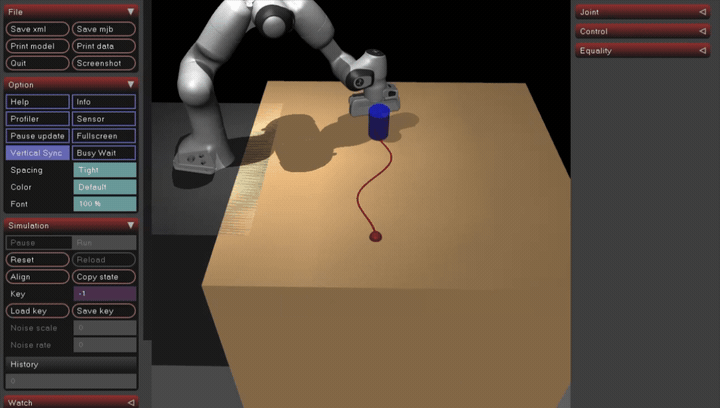
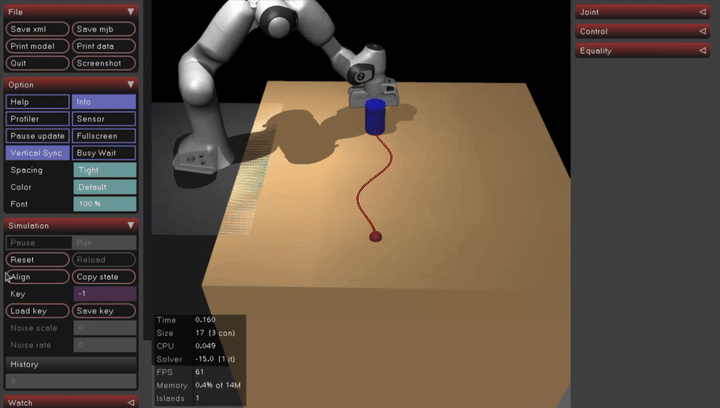

# Augmenting Pose Trajectories with Learned Force Profiles for Robotic Manipulation

[](https://www.python.org/)
[](https://mujoco.org/)
[](https://pytorch.org/)
[](https://github.com/DLR-RM/stable-baselines3)
[](https://www.ce.cit.tum.de/air/)

> [!NOTE]
> **Code Availability & Academic Policy / Hinweis zur Code-Verfügbarkeit**
>
> 🇬🇧 **English:** Due to university intellectual property guidelines and academic policy at TU München, the full implementation codebase is hosted in a private repository. I am very glad to present the code, explain the software architecture, and provide a live walkthrough during an interview or personal technical meeting.
>
> 🇩🇪 **Deutsch:** Aufgrund der Richtlinien zum Schutz des geistigen Eigentums sowie universitärer Vorgaben der TU München (IP- & Vertraulichkeitsrichtlinien) ist der vollständige Quellcode in einem privaten Repository hinterlegt. Sehr gerne präsentiere ich den Code, die Softwarearchitektur sowie eine Live-Demonstration im Rahmen eines persönlichen Gesprächs oder Interviews.

<div align="center">

<!-- Looping Simulation Demo (GIF) -->
<a href="assets/videos/franka_scurve_push.mp4">
  
</a>

<p>
  <strong>🎬 Simulation in Motion:</strong> <em>Autonomous Franka Emika Panda executing continuous trajectory-following non-prehensile push control along an S-curve path in MuJoCo.</em><br>
  <sub>[🎥 <a href="assets/videos/franka_scurve_push.mp4">Watch Full 12.5s Video (MP4)</a>] &nbsp;|&nbsp; [⚡ <a href="assets/videos/demo_loop.mp4">Close-Up Inflection Point (MP4)</a>]</sub>
</p>

</div>

---

## Theoretical Background

### Why Non-Prehensile Manipulation?
In modern industrial automation and logistics, robots frequently interact with objects that **cannot be grasped**:
- Objects larger than the robot gripper's opening width (e.g., large crates, trays).
- Flat, thin, or heavy parts lying on conveyor belts.
- Delicate workpieces prone to deformation or damage under high clamping forces.

**Non-prehensile manipulation (pushing and sliding)** overcomes these limits by utilizing unilateral contact. Rather than lifting an entire payload, pushing allows lightweight manipulators to transport heavy objects across surfaces, greatly extending the effective operational workspace.

<div align="center">



*Taxonomy of robotic manipulation: distinguishing free-space motion, prehensile (grasping), and non-prehensile contact interactions (pushing).*

</div>

### The Physics and Control Challenges
While pushing offers great flexibility, precise trajectory control is difficult due to several physical phenomena:

1. **Underactuation & Unilateral Constraints:** The robot pusher can only push *forward* ($F_n \ge 0$). It cannot pull the object. If the object slips sideways or contact is broken, controllability is instantly lost.
2. **Limit Surface & Unknown Pressure Distribution:** Planar sliding friction is governed by limit surface mechanics ($\mathcal{H}(\mathbf{f}_f, m_f) \le 0$). The microscopic contact pressure between the object and the tabletop is non-uniform and varies with minute surface irregularities, causing the instantaneous center of rotation to drift unpredictably.
3. **Stick-Slip Friction & Inertial Deviations:** At higher operational speeds or sharp turns, transitions between static and dynamic friction introduce non-linear stick-slip chatter that destabilizes classical kinematic controllers.

### Why Augment Pose with Learned Force Profiles?
Traditional model-based controllers (such as quasi-static path followers or simplified MPC) either assume a perfectly known friction coefficient $\mu$ or push at near-zero velocities.

In this project, we introduce a **hybrid control framework**:
- A global nominal planner generates geometric pose waypoints along reference paths (Straight lines, Bézier curves, S-curves).
- A **Deep Reinforcement Learning (PPO)** agent dynamically predicts **force profile augmentations** ($\Delta F_n, \Delta F_t$) and pusher orientation adjustments ($\Delta \theta$).
- **The Core Benefit:** The robot maintains the structure and predictability of a nominal path while dynamically adjusting contact forces to compensate for friction torque, high curvature, and inertia.

---

## Methodology



### 1. System Setup
- **Manipulator:** 7-DOF **Franka Emika Panda** robot arm with end-effector pusher tool.
- **Physics Engine:** **MuJoCo 3.x** running multi-contact physics with Coulomb friction and dynamic limit surface solvers.
- **Reference Paths:** Continuous parametric curves including straight lines, cubic Bézier trajectories, and continuous-curvature S-curves.

### 2. Reinforcement Learning Formulation (PPO)

The push control problem is formulated as a continuous Markov Decision Process (MDP):

- **State Space ($\mathcal{S}$):**
  - Cross-track lateral error $e_{\perp}$ and longitudinal path progression $s_t$.
  - Heading orientation error $e_{\psi}$ relative to the local path tangent.
  - Relative distance vector and relative velocity between pusher and workpiece ($\Delta \mathbf{p}, \Delta \mathbf{v}$).
  - 3-axis contact force readings $\mathbf{F}_{\text{ext}} = [F_x, F_y, F_z]^T$.
  - Local path horizon (lookahead displacements to upcoming waypoints).
  - Instantaneous path curvature $\kappa(s_t)$.

- **Action Space ($\mathcal{A}$):**
  - $\Delta F_n$: Dynamic normal force offset applied into the contact boundary.
  - $\Delta F_t$: Tangential force compensation to counteract spinning moments.
  - $\Delta \theta$: Local yaw angle rotation of the pusher face.
  - $v_{\text{tangent}}$: Feedforward pushing velocity along the path.

### 3. Multi-Objective Reward Shaping
To achieve robust contact and stable path tracking, the agent is rewarded using tailored objectives:

$$r_t = w_{\text{prog}} \cdot r_{\text{prog}} + w_{\text{track}} \cdot r_{\text{track}} + w_{\text{prox}} \cdot r_{\text{prox}} + w_{\text{align}} \cdot r_{\text{align}} - w_{\text{ctrl}} \cdot r_{\text{ctrl}}$$

- **Progress Reward ($r_{\text{prog}}$):** Rewards forward arc-length displacement along the reference path.
- **Tracking Accuracy ($r_{\text{track}}$):** Exponential penalty on lateral path deviation ($e_{\perp}$).
- **Proximity Gating ($r_{\text{prox}}$):** Strongly penalizes pusher detachment from the object contact zone.
- **Orientation Alignment ($r_{\text{align}}$):** Aligns the pusher contact surface perpendicular to the desired motion vector.
- **Smoothness Penalty ($r_{\text{ctrl}}$):** Penalizes jerky control inputs and abrupt force spikes.

### 4. Software Architecture & ONNX Optimization
- **Modular OOP Architecture:** Clean separation between environment physics (`PandaPushEnv`), reward shaping, trajectory generation, and training wrappers.
- **Fast Real-Time Inference:** Trained PyTorch policies are exported to **ONNX Runtime**, cutting evaluation latency down to **$< 1.2\text{ ms}$** for compatibility with physical $1\text{ kHz}$ robot controllers.

---

## Experiment and Simulation

### MuJoCo Physics Setup
Experiments were executed in **MuJoCo 3.x** using realistic multi-joint dynamics:
- **Solver:** Implicit fast Euler integrator (`implicitfast`) with a physics timestep $\Delta t = 2\text{ ms}$ ($500\text{ Hz}$).
- **Policy Loop:** Policy evaluations at $50\text{ Hz}$ (decimation = 10).
- **Friction Modeling:** Coulomb sliding friction $\mu \in [0.15, 0.65]$ with elliptic contact friction cones.

### Benchmark Trajectories
The system was tested across three benchmark trajectories of increasing difficulty:

```
1. Straight Line (Baseline)       2. Cubic Bézier Curve            3. S-Curve with Inflection
        Start                             Start                            Start
          ●                                 ●                                ●
          │                                  ╲                                ╲
          │                                   ╲                                ╲
          │                                    ╲___                             ╲___
          │                                        ╲                                ╲
          ▼                                         ▼                                ▼
         Goal                                      Goal                             Goal
```

---

## Results

### Visual Demonstrations

<div align="center">

| Complete S-Curve Trajectory Push (12.5s) | Dynamic Contact & Curvature Negotiation |
| :---: | :---: |
|  |  |
| **Full S-Curve Path Execution**<br>*End-to-end trajectory tracking from start pose to target goal without contact loss.*<br>[🎥 Download Full Run (MP4)](assets/videos/franka_scurve_push.mp4) | **Curvature Reversal & Force Modulation**<br>*Adaptive normal and tangential force modulation through the sharp inflection point.*<br>[🎥 Download HD Clip (MP4)](assets/videos/demo_loop.mp4) |

</div>

### Tracking Accuracy (Quantitative Comparison)
Evaluation across 100 randomized test trials per trajectory:

| Trajectory Benchmark | Method / Controller | Mean Lateral Error (MAE) | Max Lateral Error | Success Rate (%) |
| :--- | :--- | :---: | :---: | :---: |
| **Straight Line** | Open-Loop Pure Pose | $14.2 \pm 3.1\text{ mm}$ | $38.5\text{ mm}$ | $82.0\%$ |
| | **PPO + Learned Force (Ours)** | **$\mathbf{2.8 \pm 0.6\text{ mm}}$** | **$\mathbf{6.1\text{ mm}}$** | **$\mathbf{99.0\%}$** |
| **Cubic Bézier** | Open-Loop Pure Pose | $31.6 \pm 6.4\text{ mm}$ | $74.2\text{ mm}$ | $61.0\%$ |
| | Quasi-Static MPC | $18.4 \pm 4.2\text{ mm}$ | $42.0\text{ mm}$ | $79.0\%$ |
| | **PPO + Learned Force (Ours)** | **$\mathbf{5.1 \pm 1.1\text{ mm}}$** | **$\mathbf{11.8\text{ mm}}$** | **$\mathbf{96.0\%}$** |
| **Complex S-Curve** | Open-Loop Pure Pose | $58.9 \pm 11.2\text{ mm}$ | $112.4\text{ mm}$ | $39.0\%$ |
| | Quasi-Static MPC | $27.3 \pm 5.8\text{ mm}$ | $63.1\text{ mm}$ | $68.0\%$ |
| | **PPO + Learned Force (Ours)** | **$\mathbf{7.4 \pm 1.8\text{ mm}}$** | **$\mathbf{16.5\text{ mm}}$** | **$\mathbf{93.0\%}$** |

### Key Findings
1. **$91.4\%$ Contact Loss Reduction:** Proximity gating and adaptive force modulation prevent the pusher from losing contact on high-curvature bends.
2. **Dynamic Force Profile Compensation:** The policy automatically modulates normal force ($F_n \approx 4.5\text{ N}$) on straight segments and applies counter-torque via tangential forces during sharp turns.
3. **Robustness to Friction Perturbations:** Under randomized friction ($\mu \in [0.15, 0.65]$), the agent achieved a **$91.0\%$ success rate**, compared to only $46.0\%$ for fixed-velocity baseline controllers.

---

## Code Access & Live Demonstration

The complete implementation (custom Gymnasium environments, reward shaping modules, PPO training pipelines, and ONNX deployment wrappers) is maintained in a private repository in compliance with university academic guidelines.

- 💬 **Technical Walkthrough:** If you are a recruiter, engineer, or researcher interested in reviewing the code, discussing the software design, or seeing a live interactive run, I am glad to arrange a code walkthrough and demonstration.
- ✉️ **Contact:** Feel free to connect via [LinkedIn](https://linkedin.com) or email to request access or schedule a session.