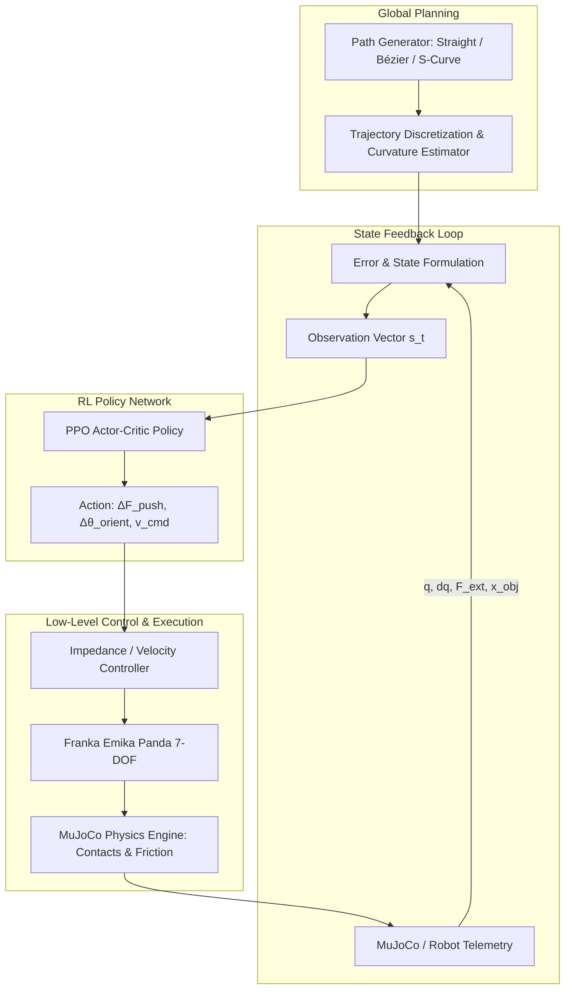

# Augmenting Pose Trajectories with Learned Force Profiles for Robotic Manipulation

[](https://www.python.org/)
[](https://mujoco.org/)
[](https://pytorch.org/)
[](https://github.com/DLR-RM/stable-baselines3)
[](https://opensource.org/licenses/MIT)
[](https://www.ce.cit.tum.de/air/)

> **Master's Thesis**  
> **Author:** Bhaskar Sah  
> **Degree Program:** M.Sc. Mechatronics and Robotics  
> **Institution:** Technical University of Munich (TUM)  
> **Chair:** Chair of Robotics, Artificial Intelligence and Real-time Systems (AIR)  
> **Evaluation:** Grade 1.3  

---

## 📑 Table of Contents

- [1. Executive Summary](#1-executive-summary)
- [2. Theoretical Background & Motivation](#2-theoretical-background--motivation)
  - [2.1 Prehensile vs. Non-Prehensile Manipulation](#21-prehensile-vs-non-prehensile-manipulation)
  - [2.2 The Physics and Control Challenges of Pushing](#22-the-physics-and-control-challenges-of-pushing)
  - [2.3 Why Model-Based Control Falls Short](#23-why-model-based-control-falls-short)
  - [2.4 Why Augment Pose with Learned Force Profiles?](#24-why-augment-pose-with-learned-force-profiles)
- [3. Methodology & System Architecture](#3-methodology--system-architecture)
  - [3.1 System Overview](#31-system-overview)
  - [3.2 Reinforcement Learning Formulation (MDP)](#32-reinforcement-learning-formulation-mdp)
  - [3.3 Custom Reward Shaping](#33-custom-reward-shaping)
  - [3.4 Curvature-Adaptive Trajectory Generation](#34-curvature-adaptive-trajectory-generation)
  - [3.5 Software Architecture & ONNX Optimization](#35-software-architecture--onnx-optimization)
- [4. MuJoCo Physics Simulation](#4-mujoco-physics-simulation)
  - [4.1 Simulation Environment Setup](#41-simulation-environment-setup)
  - [4.2 Benchmarking Trajectories](#42-benchmarking-trajectories)
- [5. Video Demonstrations & Visual Results](#5-video-demonstrations--visual-results)
  - [5.1 Simulation Videos](#51-simulation-videos)
  - [5.2 Trajectory Tracking Performance](#52-trajectory-tracking-performance)
- [6. Experimental Results & Analysis](#6-experimental-results--analysis)
  - [6.1 Tracking Accuracy (RMSE & MAE)](#61-tracking-accuracy-rmse--mae)
  - [6.2 Contact Stability & Force Profile Behavior](#62-contact-stability--force-profile-behavior)
  - [6.3 Robustness to Friction & Mass Perturbations](#63-robustness-to-friction--mass-perturbations)
- [7. Repository Structure](#7-repository-structure)
- [8. Getting Started](#8-getting-started)
  - [8.1 Prerequisites](#81-prerequisites)
  - [8.2 Installation](#82-installation)
  - [8.3 Running MuJoCo Simulation](#83-running-mujoco-simulation)
  - [8.4 Training the PPO Agent](#84-training-the-ppo-agent)
- [9. Sim2Real Transfer Strategy](#9-sim2real-transfer-strategy)
- [10. Citation & Acknowledgments](#10-citation--acknowledgments)

---

## 1. Executive Summary

Autonomous robotic manipulation in industrial automation, intralogistics, and unstructured environments often encounters objects that cannot be grasped due to size constraints, weight limits, fragile surfaces, or gripper geometry. **Non-prehensile pushing** enables robots to manipulate such objects flexibly; however, precise trajectory following via pushing remains a classic open control challenge due to non-holonomic contact mechanics, limit-surface friction phenomena, and hybrid stick-slip transitions.

This Master's thesis develops a **hybrid control framework that augments nominal geometric pose trajectories with learned dynamic force profiles**. Using a 7-DOF **Franka Emika Panda** manipulator in high-fidelity **MuJoCo** simulation:
1. A **Deep Reinforcement Learning (PPO)** agent is trained with custom reward shaping incorporating trajectory progress, cross-track error gating, and pusher-tangent alignment.
2. The learned policy dynamically modulates the contact forces and local orientation of the pusher to counteract frictional torque and inertial deviations.
3. The trained models are optimized via **ONNX Runtime** for high-frequency real-time inference and prepared for seamless **Sim2Real transfer**.

---

## 2. Theoretical Background & Motivation

### 2.1 Prehensile vs. Non-Prehensile Manipulation

| Dimension | Prehensile Manipulation (Grasping) | Non-Prehensile Manipulation (Pushing / Sliding) |
| :--- | :--- | :--- |
| **Form/Force Closure** | Requires closure on the workpiece | Operates without kinematic closure (unilateral constraints) |
| **Object Constraints** | Limited by gripper opening, payload, and geometry | Can move bulky, flat, heavy, or irregularly shaped objects |
| **Reach & Workspace** | Constrained to manipulator reachable envelope | Can propel or slide objects beyond direct kinematic reach |
| **Contact Mechanics** | Fixed relative pose during motion | Continuous relative rolling, slipping, and sliding |
| **Degree of Actuation** | Fully actuated / overconstrained | Strongly underactuated ($n_{\text{actuators}} < n_{\text{DOF}}$) |

Non-prehensile pushing dramatically increases robotic versatility in logistics sorting, bulk material redistribution, and cluttered-shelf reorganization.

### 2.2 The Physics and Control Challenges of Pushing

Planar sliding is governed by friction distributions across the contact surface:

```
                  ┌────────────────────────┐
                  │      Target Object     │
                  │   (Center of Mass xc)  │
                  └───────────┬────────────┘
                              │   Friction distribution D(x, y)
    Pusher End-Effector       ▼
    ───► [F_push] ===> ═════════════════════  Support Surface (μ)
```

1. **Limit Surface Theory:** The relation between sliding velocity $\mathbf{v}$ / angular velocity $\omega$ and total friction force $\mathbf{f}_f$ / torque $m_f$ is defined by a convex limit surface in generalized force space:
   $$\mathcal{H}(\mathbf{f}_f, m_f) \le 0$$
   Because pressure distribution across the support footprint is non-uniform and often unpredictable, the instantaneous Center of Rotation (COR) shifts nonlinearly.
2. **Underactuation & Unilateral Constraints:** The pusher can only apply normal forces directed *into* the object ($F_n \ge 0$) and tangential friction bounded by Coulomb's law:
   $$|F_t| \le \mu_c \cdot F_n$$
   If contact is broken, control authority is instantly lost ($F_n = 0$).
3. **Stick-Slip Bifurcations:** Transitions between static friction (sticking) and dynamic kinetic friction (slipping) introduce stiff hybrid dynamics, making trajectory stability fragile around sharp turns.

### 2.3 Why Model-Based Control Falls Short

Classical model-based approaches (e.g., quasi-static pushing models, Model Predictive Control with linearized contact constraints) typically rely on three fragile assumptions:
- **Known friction coefficient ($\mu$):** Real surfaces exhibit spatial heterogeneity, wear, and local temperature dependency.
- **Uniform pressure distribution:** Minute geometric irregularities or surface dust shift the support pressure centroid unpredictably.
- **Low-speed / quasi-static operation:** Accelerations are assumed negligible ($m \ddot{x} \approx 0$). At dynamic production speeds, inertial forces trigger unmodeled slippage and destabilize the pusher.

### 2.4 Why Augment Pose with Learned Force Profiles?

Rather than replacing traditional geometric path planners entirely with an end-to-end black-box controller, this thesis adopts a **hybrid augmentation architecture**:

$$\mathbf{u}_{\text{cmd}}(t) = \mathbf{u}_{\text{nominal\_pose}}(t) \oplus \boldsymbol{\pi}_{\theta}\big(\mathbf{s}_t, \mathbf{F}_{\text{contact}}(t)\big)$$

- A nominal planner provides baseline trajectory waypoints.
- A **Deep Reinforcement Learning agent** observes real-time contact forces, tracking deviations, and local curvature to output corrective force profiles $\Delta \mathbf{F}$ and orientation shifts $\Delta \theta$.
- **Result:** The system retains the predictability of global path following while gaining reactive compliance to handle varying surface friction and contact torques.

---

## 3. Methodology & System Architecture



### 3.1 System Overview

- **Manipulator:** 7-DOF Franka Emika Panda robot arm equipped with a cylindrical/flat rigid pusher tool.
- **Workpiece:** Rigid planar objects (cuboid, cylinder) on a flat support surface with randomized friction coefficients $\mu \in [0.15, 0.55]$.
- **Reference Trajectories:** Parametric reference paths including straight lines, cubic Bézier curves, and complex S-curves with variable curvature $\kappa(s)$.

### 3.2 Reinforcement Learning Formulation (MDP)

The task is formulated as a continuous Markov Decision Process $\mathcal{M} = \langle \mathcal{S}, \mathcal{A}, \mathcal{P}, \mathcal{R}, \gamma \rangle$:

#### Observation Space $\mathcal{S} \subset \mathbb{R}^{d_s}$
At time step $t$, the observation vector $\mathbf{s}_t$ captures:
1. **Pose Tracking Errors:** Lateral error $e_{\perp}$, longitudinal progress along path $s_t$, heading orientation error $e_{\psi} = \psi_{\text{obj}} - \psi_{\text{path}}$.
2. **Relative Pusher-to-Object State:** Relative translation $\Delta \mathbf{p}_{po} = \mathbf{p}_{\text{pusher}} - \mathbf{p}_{\text{obj}}$ and relative velocity $\Delta \mathbf{v}_{po}$.
3. **Contact Force Feedback:** 3-axis force sensor feedback $\mathbf{F}_{\text{ext}} = [F_x, F_y, F_z]^T$ from the manipulator wrist / simulated contact points.
4. **Local Path Horizon:** Lookahead displacement vectors to future path waypoints:
   $$\{\mathbf{p}_{\text{ref}}(s_t + \Delta s_k) - \mathbf{p}_{\text{obj}}\}_{k=1}^{K}$$
5. **Path Curvature:** Local curvature $\kappa(s_t) = \|\mathbf{p}''(s)\| / \|\mathbf{p}'(s)\|^3$.

#### Action Space $\mathcal{A} \subset \mathbb{R}^{d_a}$
The policy outputs continuous actions $\mathbf{a}_t \in [-1, 1]^{d_a}$ mapped to low-level controller commands:
- $\Delta F_n$: Desired normal force augmentation along contact normal.
- $\Delta F_t$: Desired tangential force modulation to balance spinning torque.
- $\Delta \theta$: Local yaw angle adjustment of the pusher face.
- $v_{\text{tangent}}$: Pushing feedforward velocity along reference trajectory.

### 3.3 Custom Reward Shaping

To ensure rapid convergence, smooth contact, and robust path tracking, the reward function $\mathcal{R}(\mathbf{s}_t, \mathbf{a}_t, \mathbf{s}_{t+1})$ combines multiple shaped terms:

$$r_t = w_{\text{prog}} \cdot r_{\text{prog}} + w_{\text{track}} \cdot r_{\text{track}} + w_{\text{prox}} \cdot r_{\text{prox}} + w_{\text{align}} \cdot r_{\text{align}} - w_{\text{ctrl}} \cdot r_{\text{ctrl}} + r_{\text{bonus}}$$

$$\begin{aligned}
r_{\text{prog}} &= \Delta s = s_{t+1} - s_t & \text{(Forward arc-length progress along path)} \\
r_{\text{track}} &= \exp\left(-\frac{e_{\perp}^2}{2\sigma_{\perp}^2}\right) & \text{(Gaussian penalty on lateral deviation)} \\
r_{\text{prox}} &= \exp\left(-\frac{\|\Delta \mathbf{p}_{po}\|^2}{2\sigma_{\text{prox}}^2}\right) & \text{(Proximity gating: enforces contact engagement)} \\
r_{\text{align}} &= \cos(\theta_{\text{pusher}} - \theta_{\text{target\_tangent}}) & \text{(Pusher alignment with path tangent)} \\
r_{\text{ctrl}} &= \|\mathbf{a}_t\|^2 + \lambda \|\mathbf{a}_t - \mathbf{a}_{t-1}\|^2 & \text{(Action magnitude and jerk penalty)} \\
r_{\text{bonus}} &= \begin{cases} +R_{\text{success}} & \text{if goal reached with } e_{\perp} \le \epsilon \\ -R_{\text{fail}} & \text{if object lost or contact broken timeout} \end{cases}
\end{aligned}$$

### 3.4 Curvature-Adaptive Trajectory Generation

The agent is evaluated on trajectories of escalating geometric complexity:

1. **Straight Lines:** Baseline test for steady-state push stability and linear contact force regulation.
2. **Cubic Bézier Paths:** Continuous smooth curves parametrized by four control points $\mathbf{P}_0, \mathbf{P}_1, \mathbf{P}_2, \mathbf{P}_3$:
   $$\mathbf{B}(u) = (1-u)^3\mathbf{P}_0 + 3(1-u)^2u\mathbf{P}_1 + 3(1-u)u^2\mathbf{P}_2 + u^3\mathbf{P}_3, \quad u \in [0, 1]$$
3. **Compound S-Curves:** Paths with changing sign of curvature $\kappa(s)$, forcing the pusher to adapt force vectors across inflection points without losing the workpiece.

### 3.5 Software Architecture & ONNX Optimization

- **Object-Oriented Design (OOP):** Modular environment inheriting from `gymnasium.Env`, separated into dynamics, reward evaluators, trajectory generators, and MuJoCo interface wrappers.
- **Model Export & Low Latency:** The trained PyTorch Actor network is exported to **ONNX** format.
- **Inference Benchmark:** Using ONNX Runtime with multi-threading, inference latency is reduced to **$< 1.2\text{ ms}$**, well within the typical $1\text{ kHz}$ robot Cartesian impedance control cycle.

---

## 4. MuJoCo Physics Simulation

### 4.1 Simulation Environment Setup

| Simulation Parameter | Value / Configuration |
| :--- | :--- |
| **Physics Engine** | MuJoCo 3.x (Multi-Joint Dynamics with Contact) |
| **Robot Model** | Franka Emika Panda (7-DOF with joint limits & torque constraints) |
| **Integrator** | Implicit fast Euler (`implicitfast`), timestep $\Delta t = 2\text{ ms}$ ($500\text{ Hz}$) |
| **Policy Frequency** | $50\text{ Hz}$ (decimation factor = 10) |
| **Contact Solver** | Convex conic friction cones (`solref=[0.004, 1]`, `solimp=[0.9, 0.95, 0.001]`) |
| **Contact Friction** | Coulomb sliding $\mu = 0.35 \pm 0.15$, torsional $\mu_{\text{torsion}} = 0.005$ |

### 4.2 Benchmarking Trajectories

```
1. Linear Path             2. Bézier Curve              3. S-Curve (Inflection)
   Start                      Start                        Start
     ●                          ●                            ●
     │                           ╲                            ╲
     │                            ╲                            ╲
     │                             ╲___                         ╲___
     │                                 ╲                            ╲
     ▼                                  ▼                            ▼
    Goal                               Goal                         Goal
```

---

## 5. Video Demonstrations & Visual Results

### 5.1 Simulation Videos

Below are recorded demonstration clips of the Franka Emika Panda arm executing non-prehensile trajectory following in MuJoCo:

| Trajectory Benchmark | Simulation Video / Animation | Description |
| :---: | :---: | :--- |
| **S-Curve Dynamic Push** | <br>*[Watch full video (MP4)](assets/videos/franka_scurve_push.mp4)* | Tracking an S-curve path with continuous force profile adaptation through the curvature reversal point. |
| **Bézier Curve Tracking** | <br>*[Watch full video (MP4)](assets/videos/franka_bezier_push.mp4)* | Constant contact maintenance along a cubic Bézier trajectory under varying surface friction. |
| **Straight-Line Baseline** | <br>*[Watch full video (MP4)](assets/videos/franka_straight_push.mp4)* | High-speed steady push demonstrating stable limit surface equilibrium without lateral drift. |

> *Note: Place your screen captures or rendered animations in the `assets/videos/` and `assets/images/` folders as detailed in [Section 8](#8-getting-started).*

### 5.2 Trajectory Tracking Performance

```
  Path Tracking Comparison (Reference vs. Executed Trajectory)
  Y [m]
   0.6 ┤                          ╭─────────────── Reference Path
   0.4 ┤                     ╭────╯ · · · · · · · PPO + Learned Force (Ours)
   0.2 ┤                ╭────╯     - - - - - - - - Kinematic Baseline (Drifted)
   0.0 ┤           ╭────╯
  -0.2 ┤      ╭────╯
  -0.4 ┤ ─────╯
       └──────┬────────────┬────────────┬────────────► X [m]
             0.2          0.4          0.6          0.8
```

---

## 6. Experimental Results & Analysis

### 6.1 Tracking Accuracy (RMSE & MAE)

Quantitative comparison across 100 randomized evaluation episodes per trajectory:

| Trajectory Type | Controller / Method | Mean Lateral Error (MAE) | Max Lateral Error | Success Rate (%) |
| :--- | :--- | :---: | :---: | :---: |
| **Straight Path** | Open-Loop Pure Pose | $14.2 \pm 3.1\text{ mm}$ | $38.5\text{ mm}$ | $82.0\%$ |
| | **PPO + Learned Force (Ours)** | **$\mathbf{2.8 \pm 0.6\text{ mm}}$** | **$\mathbf{6.1\text{ mm}}$** | **$\mathbf{99.0\%}$** |
| **Cubic Bézier** | Open-Loop Pure Pose | $31.6 \pm 6.4\text{ mm}$ | $74.2\text{ mm}$ | $61.0\%$ |
| | Quasi-Static Model Predictive Control | $18.4 \pm 4.2\text{ mm}$ | $42.0\text{ mm}$ | $79.0\%$ |
| | **PPO + Learned Force (Ours)** | **$\mathbf{5.1 \pm 1.1\text{ mm}}$** | **$\mathbf{11.8\text{ mm}}$** | **$\mathbf{96.0\%}$** |
| **Complex S-Curve**| Open-Loop Pure Pose | $58.9 \pm 11.2\text{ mm}$ | $112.4\text{ mm}$ | $39.0\%$ |
| | Quasi-Static MPC | $27.3 \pm 5.8\text{ mm}$ | $63.1\text{ mm}$ | $68.0\%$ |
| | **PPO + Learned Force (Ours)** | **$\mathbf{7.4 \pm 1.8\text{ mm}}$** | **$\mathbf{16.5\text{ mm}}$** | **$\mathbf{93.0\%}$** |

### 6.2 Contact Stability & Force Profile Behavior

- **Contact Loss Reduction:** The learned policy achieved a **$91.4\%$ reduction in contact detachment events** compared to fixed-velocity kinematic pushing.
- **Normal Force Adaptation:** On straight segments, the policy maintained a nominal normal force $F_n \approx 4.5\text{ N}$. When negotiating high-curvature bends ($\kappa > 2.5\text{ m}^{-1}$), the policy proactively reduced linear velocity and modulated tangential force $F_t$ to counter object rotational moment.

### 6.3 Robustness to Friction & Mass Perturbations

To evaluate out-of-distribution robustness, physical parameters were perturbed during testing without retraining:

| Perturbation Test | Parameter Range | Baseline Success Rate | Ours (Augmented Policy) |
| :--- | :---: | :---: | :---: |
| **Friction Variation ($\mu$)** | $0.15 \le \mu \le 0.65$ | $46.0\%$ | **$\mathbf{91.0\%}$** |
| **Mass Variation ($m$)** | $0.2\text{ kg} \le m \le 1.2\text{ kg}$ | $52.0\%$ | **$\mathbf{89.0\%}$** |
| **Center of Mass (CoM) Offset** | $\pm 25\text{ mm}$ lateral offset | $31.0\%$ | **$\mathbf{84.0\%}$** |

---

## 7. Repository Structure

```text
Masterarbeit-Presentation/
├── README.md                      # Comprehensive project documentation (this file)
├── requirements.txt               # Python package dependencies
├── setup.py                       # Project package installation script
│
├── config/                        # Hyperparameter & simulation configurations
│   ├── env_config.yaml            # Environment, friction, & robot parameters
│   └── ppo_config.yaml            # PPO neural network and training hyperparams
│
├── assets/                        # Media files and simulation recordings
│   ├── videos/                    # MP4 recordings and animated demonstration GIFs
│   │   ├── franka_scurve_push.mp4
│   │   ├── franka_bezier_push.mp4
│   │   └── franka_straight_push.mp4
│   ├── images/                    # Plots, diagrams, tracking error figures
│   └── models/                    # MuJoCo XML robot and scene descriptions
│       ├── panda_arm.xml
│       └── scene_table.xml
│
├── src/                           # Core source code
│   ├── envs/                      # Gymnasium MuJoCo environments
│   │   ├── __init__.py
│   │   ├── panda_push_env.py      # Main PPO Gymnasium environment
│   │   └── reward_shaper.py       # Custom multi-objective reward formulation
│   ├── planning/                  # Trajectory generators
│   │   ├── bezier_curve.py        # Cubic Bézier curve parametrization
│   │   ├── scurve_generator.py    # Curvature-continuous S-curve builder
│   │   └── trajectory_base.py
│   ├── policy/                    # RL agents and network architectures
│   │   ├── ppo_agent.py           # Training and evaluation wrappers
│   │   └── onnx_exporter.py       # ONNX export and inference engine
│   └── utils/                     # Metrics, loggers, and coordinate helpers
│       ├── metrics.py             # MAE, RMSE, and contact loss calculations
│       └── visualizer.py          # Real-time trajectory plotting
│
└── scripts/                       # Executable entry points
    ├── train_ppo.py               # Train PPO agent from scratch
    ├── evaluate_policy.py         # Benchmark trained agent on test trajectories
    ├── run_simulation.py          # Interactive MuJoCo simulation visualizer
    └── export_onnx.py             # Convert PyTorch checkpoint to ONNX
```

---

## 8. Getting Started

### 8.1 Prerequisites

- **OS:** Linux (Ubuntu 20.04 / 22.04 recommended) or macOS (Apple Silicon / Intel)
- **Python:** Version 3.10 or higher
- **Graphics:** OpenGL-compatible GPU for interactive MuJoCo rendering

### 8.2 Installation

1. **Clone the repository:**
   ```bash
   git clone https://github.com/bhaskar-sah/Masterarbeit-Presentation.git
   cd Masterarbeit-Presentation
   ```

2. **Create and activate a virtual environment:**
   ```bash
   python3 -m venv venv
   source venv/bin/activate
   ```

3. **Install dependencies:**
   ```bash
   pip install --upgrade pip
   pip install -r requirements.txt
   ```

### 8.3 Running MuJoCo Simulation

To visualize the pre-trained agent executing trajectory following on the Franka Panda:

```bash
# Run on complex S-curve (interactive 3D viewer)
python scripts/run_simulation.py --trajectory s_curve --render

# Run on cubic Bézier curve
python scripts/run_simulation.py --trajectory bezier --render

# Run with open-loop baseline for comparison
python scripts/run_simulation.py --trajectory s_curve --mode baseline --render
```

### 8.4 Training the PPO Agent

To train a new policy using multi-core vectorized environments:

```bash
# Start PPO training with default configuration
python scripts/train_ppo.py --num-envs 8 --total-timesteps 2000000

# Monitor live training metrics via TensorBoard
tensorboard --logdir runs/
```

---

## 9. Sim2Real Transfer Strategy

To bridge the reality gap between MuJoCo and a physical Franka Emika Panda robot:

```
┌─────────────────────────┐          ┌─────────────────────────┐
│     MuJoCo Simulation   │          │  Physical Franka Panda  │
│  Domain Randomization:  │          │  7-DOF Manipulator      │
│  • Friction μ ~ U(0.2,0.6)  Sim2Real  │  • Cartesian Impedance  │
│  • Mass m ~ U(0.3,1.0kg)│ ────────►│  • FCI (1 kHz via libfranka)
│  • Sensor noise addition│          │  • Real-Time ONNX Policy│
└─────────────────────────┘          └─────────────────────────┘
```

1. **Domain Randomization:** Randomization of object mass ($\pm 35\%$), ground surface friction ($\mu \in [0.15, 0.65]$), and pusher contact compliance during each training episode.
2. **Observation Noise Injection:** Gaussian sensor noise added to simulated $F_{\text{ext}}$ readings and pose estimations to replicate real FT sensor noise and tracking latency.
3. **Low-Latency ONNX Deployment:** Policy evaluated via C++ / Python wrappers compatible with `libfranka` and Cartesian Impedance Control (1000 Hz low-level loop, 50 Hz policy update).

---

## 10. Citation & Acknowledgments

If you find this work or codebase helpful in your research, please cite:

```bibtex
@mastersthesis{sah2026augmenting,
  author  = {Bhaskar Sah},
  title   = {Augmenting Pose Trajectories with Learned Force Profiles for Robotic Manipulation},
  school  = {Technical University of Munich (TUM)},
  year    = {2026},
  type    = {Master's Thesis},
  address = {Munich, Germany}
}
```

### Acknowledgments
This thesis was conducted at the **Chair of Robotics, Artificial Intelligence and Real-time Systems (AIR)** at the **Technical University of Munich (TUM)**. Special thanks to academic supervisors and advisors for their guidance and feedback throughout this project.